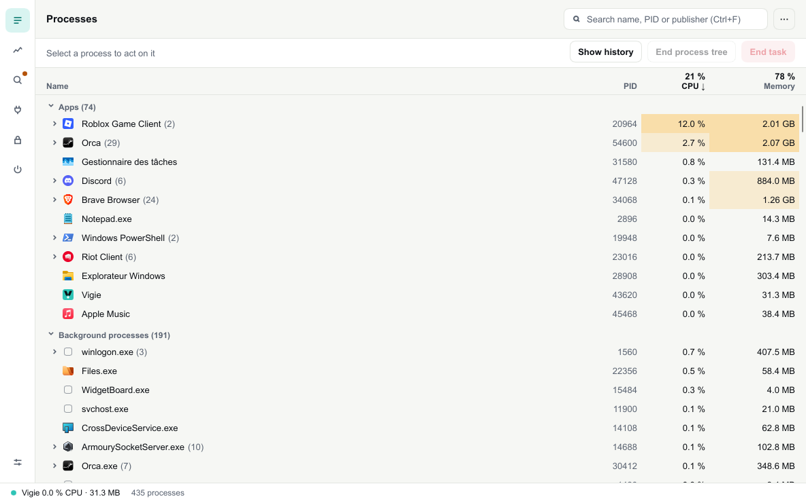
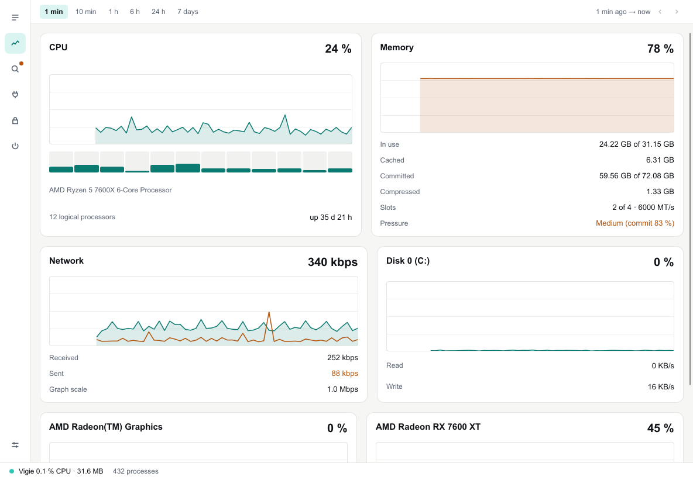
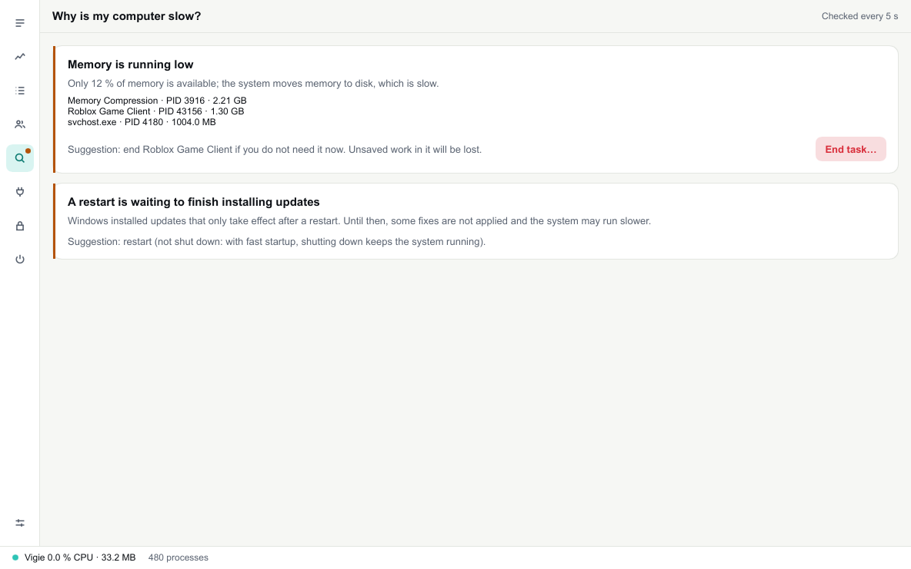
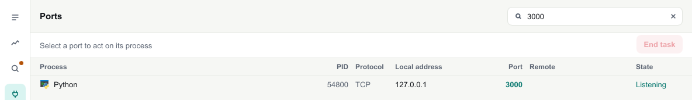
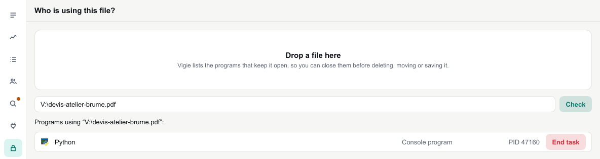
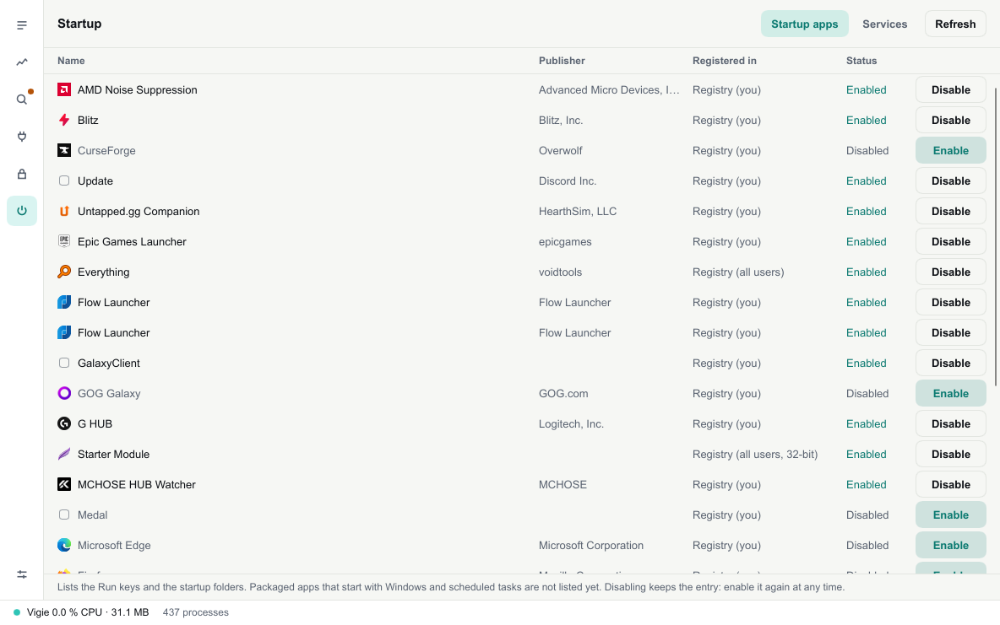
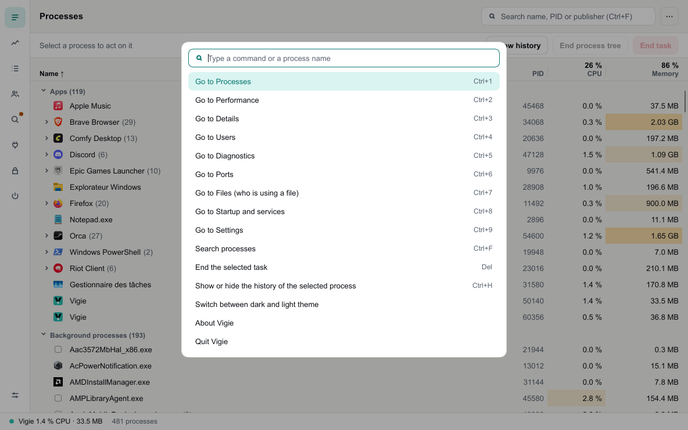

<p align="center">
  <picture>
    <source media="(prefers-color-scheme: dark)" srcset="assets/brand/vigie-lockup-horizontal-reversed.svg">
    
  </picture>
</p>

<p align="center"><strong>The task manager Windows should have shipped.</strong><br>
See what slows your computer down, why, and what to do about it. Fast, clear, and lighter than the window it replaces.</p>

<p align="center">
  <a href="https://github.com/EvanPluchart/vigie/releases/latest"></a>
  <a href="https://github.com/EvanPluchart/vigie/releases"></a>
  
  <a href="LICENSE"></a>
</p>

<p align="center">
  <a href="https://github.com/EvanPluchart/vigie/releases/latest"><strong>Download</strong></a> ·
  <a href="https://evanpluchart.github.io/vigie/en/">Website</a> ·
  <a href="https://evanpluchart.github.io/vigie/">Site en français</a> ·
  <a href="docs/ARCHITECTURE.md">How it works</a>
</p>

<p align="center">
  
</p>

**Contents:** [Features](#features) · [Compared with Task Manager](#compared-with-task-manager) · [Install](#install) · [Light by design](#light-by-design) · [Privacy](#privacy-and-security) · [Build from source](#build-from-source)

---

*Vigie* is the lookout at the top of a ship's mast: the one who watches everything. Vigie watches your machine, tells you plainly what is going on, and costs almost nothing while it does.

## Features

**Everything Task Manager does, clearer**

* **Processes grouped by app**, with real names and icons ("Brave Browser", not `brave.exe` ×25), expandable into their process tree. Columns show how heavy each one is at a glance.
* **Details and Users** views, as in Task Manager, with resizable columns you choose from the header.
* **End task, end process tree, suspend, resume, priority**, open file location, search online, copy the command line: from a right-click menu, the toolbar or the keyboard. Destructive actions always name their target and ask first; Windows' critical processes are protected.
* **Performance**: CPU per core, memory, network, every disk and GPU, with **history you can scroll back up to 7 days**.

**What Task Manager cannot tell you**

* **"Why is my computer slow?"** A diagnostics view that names the cause and suggests what to do:
  * the processor is saturated;
  * memory is running low;
  * a program keeps eating memory;
  * a restart is waiting to finish updates;
  * the system drive is almost full.
* **History per process**: select one and see its CPU and memory over time.
* **For developers**:
  * **Ports**: which process listens on port 3000.
  * **Files**: which process holds this file you cannot delete.
  * **Startup and services**: what starts with Windows, and turning it off.
* **Alerts** in a system notification when the processor stays saturated or memory runs low.

**A pleasure to use**

* **Command palette** (`Ctrl+K`) to reach any view or action, and the whole app works from the keyboard.
* **Tray icon with a mini view** of CPU and memory, and closing to the tray if you want.
* **Opens with `Ctrl+Shift+Esc`** in place of Task Manager, if you turn it on.
* **Updates itself**: Vigie tells you when a new version is out and installs it in one click.
* **Dark and light themes**, in English and French.

<table>
  <tr>
    <td></td>
    <td></td>
  </tr>
  <tr>
    <td align="center"><sub>Performance, with history</sub></td>
    <td align="center"><sub>"Why is my computer slow?"</sub></td>
  </tr>
</table>

<details>
<summary><strong>More screenshots</strong></summary>
<br>

| | |
|---|---|
|  |  |
| <p align="center"><sub>Ports</sub></p> | <p align="center"><sub>Who is using a file</sub></p> |
|  |  |
| <p align="center"><sub>Startup apps and services</sub></p> | <p align="center"><sub>Command palette</sub></p> |

</details>

## Compared with Task Manager

| | Windows Task Manager | Vigie |
|---|:---:|:---:|
| Processes grouped by app, end task, priority | ✅ | ✅ |
| End a whole process tree | — | ✅ |
| Suspend and resume a process | — | ✅ |
| CPU, memory, disk, network and GPU graphs | ✅ | ✅ |
| History you can scroll back through | — | ✅ up to 7 days |
| History of a single process | — | ✅ |
| Explains why the computer is slow | — | ✅ |
| Which process uses a port | — | ✅ |
| Which process locks a file | — | ✅ |
| Alerts when the machine struggles | — | ✅ |
| Command palette | — | ✅ |
| Shows its own CPU and memory cost | — | ✅ |

## Install

Download the latest version from the [releases page](https://github.com/EvanPluchart/vigie/releases/latest):

* **`Vigie-x.y.z-setup.exe`** installs Vigie for your account, without administrator rights. It uninstalls from Settings › Apps.
* **`Vigie-x.y.z-portable.zip`** is a single executable to run from anywhere.

Then Vigie keeps itself up to date: it checks for a new version when it starts and every 6 hours, and installs it in one click from the status bar. Turn that off in Settings › Updates.

<details>
<summary><strong>Windows warns that the file is unknown</strong></summary>
<br>

The executables are not code-signed yet, so SmartScreen may warn on first launch: choose **More info**, then **Run anyway**. Each release publishes `SHA256SUMS`, so you can check that what you downloaded is what was built:

```powershell
Get-FileHash .\Vigie-0.1.5-setup.exe -Algorithm SHA256
```

</details>

<details>
<summary><strong>Open Vigie with Ctrl+Shift+Esc</strong></summary>
<br>

Settings › Task Manager › **Open Vigie with Ctrl+Shift+Esc**. Windows only allows this machine-wide, so it asks once for administrator rights. Vigie then puts a copy of itself in `Program Files`, which only administrators can change, and points Ctrl+Shift+Esc at it ([why](docs/decisions/0011-taskmgr-replacement-hardening.md)). Each update refreshes that copy, with one more prompt. Turn the option off at any time; uninstalling Vigie turns it off too.

</details>

<details>
<summary><strong>macOS and Linux</strong></summary>
<br>

Vigie is built for Windows first. Some releases include preview packages for macOS (`.dmg`) and Linux (AppImage), which show processes only for now.

</details>

## Light by design

A task manager you open because the computer is slow must not slow it down further. Vigie shows its own cost in the status bar at all times, and stays within a budget that every change is measured against:

| | Budget | Measured |
|---|---|---|
| CPU, refreshing every second | under 1 % of one core | about 0.5 % |
| Private memory | under 30 MB | about 10 MB |

It refreshes less often when in the background or minimised, and does nothing for views you are not looking at. Written in Rust with [Slint](https://slint.dev): no browser engine, no runtime to install.

## Privacy and security

* **No account, no telemetry.** Vigie's only network request asks GitHub whether a new version is out (you can turn it off). "Search online" opens your browser only when you click it.
* **No administrator rights needed.** Processes of other accounts show what Windows allows; acting on them asks you to restart Vigie as administrator.
* **Careful with your processes.** Every action checks that the process is still the one you picked, never a new process that reused its number. Vigie refuses to end or suspend the processes Windows needs to keep running.
* **Updates are checked** against the checksum published with each release before they run.
* **Your files stay yours.** Settings live in `%APPDATA%\Vigie`. Nothing else is written.

## Build from source

You need Rust (stable) on Windows; [Inno Setup 6](https://jrsoftware.org/isinfo.php) only to build the installer.

```sh
cargo run -p vigie -- --sort=cpu       # run it (also --tab=performance, --dark, --lang=fr …)
cargo test --workspace                 # tests
cargo clippy --workspace -- -D warnings
cargo xtask bench-overhead             # Vigie's own CPU and memory over 60 s
cargo xtask dist                       # installer and portable zip in dist/
```

How it is built is in [docs/ARCHITECTURE.md](docs/ARCHITECTURE.md); settled design choices are in [docs/decisions](docs/decisions), what comes next in the [roadmap](docs/ROADMAP.md), and the art direction in [docs/BRAND.md](docs/BRAND.md).

## License

[MIT](LICENSE). The interface is built with [Slint](https://slint.dev) under its [royalty-free license](https://slint.dev/terms-and-conditions#royalty-free); the attribution is in Vigie's About window.
