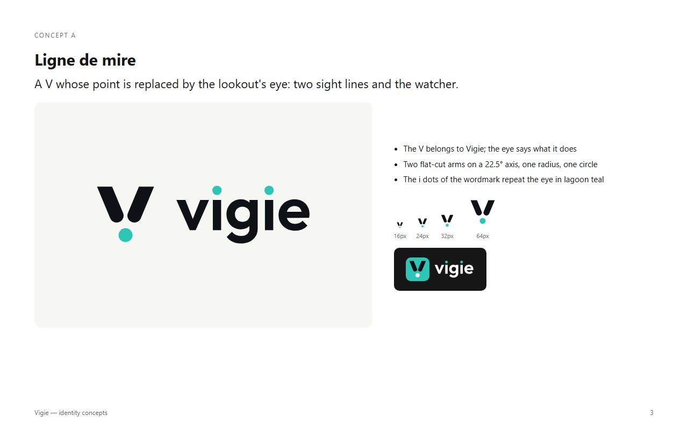
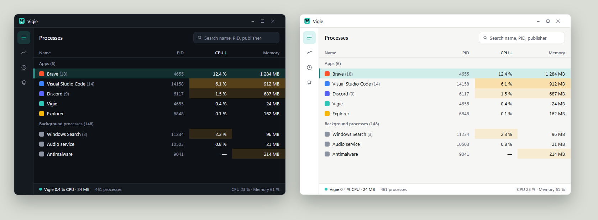

# Brand and art direction

Vigie is the lookout at the top of the mast. The identity says two things: **it watches**, and **it stays out of the way**. Calm, precise, friendly; never alarmist.

## Logo

**Idea, "Ligne de mire":** a V whose point is replaced by the lookout's eye. Two sight lines converge on the watcher. The V belongs to the name; the eye says what the app does.

Construction (256 grid, `assets/brand/source/gen.py`):

* Two arms on a 22.5° axis from vertical, 44 units thick, flat-cut at the top (y = 38), round at the end towards the eye.
* The eye: a circle of radius 22, centred on the axis, 24 units below the arms.
* The whole mark is lifted 10 units for optical centring.
* Small-size cut (`*-small.svg`), used from 16 to 48 px: arms 54 thick, eye radius 27.

### Files (`assets/brand/`)

| Use | File |
|---|---|
| App icon, taskbar, dock, tray | `vigie-icon.svg`, `vigie-icon-small.svg` (16–48 px), `icons/vigie.ico`, `icons/vigie-*.png` |
| App icon on a dark store page | `vigie-icon-dark.svg` |
| Symbol on light / dark backgrounds | `vigie-symbol-color.svg` / `vigie-symbol-reversed.svg` |
| One colour (print, engraving, stamps) | `vigie-symbol-black.svg`, `vigie-wordmark-black.svg` |
| README, website header | `vigie-lockup-horizontal.svg` (tile + wordmark), `vigie-lockup-symbol.svg` (symbol + wordmark) |
| On dark backgrounds | `vigie-lockup-horizontal-reversed.svg`, `vigie-wordmark-reversed.svg` |
| Splash, About window, square formats | `vigie-lockup-stacked.svg` |

### Rules

* **Clear space:** the eye's diameter on every side of the mark or lockup.
* **Minimum size:** icon 16 px (use the small cut below 48 px); horizontal lockup 24 px high; wordmark alone 12 px x-height.
* **The wordmark** is "vigie" in lowercase, outlined from Outfit SemiBold. Its two i dots carry the eye colour. Never retype it in a font.
* **Do not:** recolour the arms in lagoon on a lagoon tile, separate the eye from the V, rotate or tilt the mark, add a shadow, outline or gradient, put the colour symbol on a busy photo, rebuild the V from a font's V.

## Colour

| Token | Hex | Role |
|---|---|---|
| Lagoon | `#2EC4B6` | Brand colour: icon tile, eye, accents on dark |
| Ink | `#0E1116` | Arms of the V, text, dark backgrounds |
| White | `#FFFFFF` | The eye on the tile, surfaces |
| Deep lagoon | `#0B7A71` | Lagoon for text and icons on light backgrounds (5.2:1 on white) |
| Signal | `#FFB020` | Warm heat, warnings |
| Flare | `#FF5D5D` (dark) / `#D92D3A` (light) | Hot cells, critical findings, destructive actions |

Contrast checks: lagoon on ink 8.7:1, ink on lagoon 8.7:1, deep lagoon on white 5.2:1. **Lagoon on white is 2.2:1:** never use it for text or thin lines on light backgrounds; use deep lagoon. The white eye on the lagoon tile is a large graphic shape, not text, and stays visible down to 16 px (see `previews/test-sheet.png`).

## Typography

* **Brand** (wordmark, website headings, store pages): Outfit, SemiBold and Regular (SIL OFL 1.1).
* **Interface:** the system UI font, so Vigie feels native and loads nothing: Segoe UI Variable on Windows, SF Pro on macOS, the desktop's font on Linux (Inter as fallback). Numbers always use tabular figures so columns do not jitter between ticks.
* **Scale (px):** 12 caption and headers · 13 body and table · 15 section titles · 20 view titles · 28 large figures (Performance view).
* **Weights:** 400 and 600 only.

## Interface art direction

**Principles**

1. **Dark first, light equal.** Both themes are designed, not inverted. Native Slint styles (fluent, cupertino, cosmic) stay; Vigie's tokens sit on top.
2. **Numbers first.** Right-aligned, tabular, units after a thin space. Missing values are "—", never 0.
3. **Heat is a tint, not a colour shout.** Hot cells get a background tint (signal, then flare); text stays in the text colour. Three steps, same thresholds in both themes.
4. **Calm on every tick.** No flash, no animation when values refresh; rows do not jump when a value changes by a hair. Motion only on user actions (120 ms ease-out).
5. **The eye is "live".** The lagoon dot appears where Vigie reports on itself: the status bar's self-cost, the tray icon.

**Tokens** (to become a Slint global in D2)

| Token | Dark | Light |
|---|---|---|
| `background` | `#0E1116` | `#F6F7F4` |
| `surface` | `#151A21` | `#FFFFFF` |
| `raised` | `#1B212A` | `#FFFFFF` |
| `border` | `#252C37` | `#E3E6E1` |
| `text` | `#E6EAF0` | `#0E1116` |
| `text-muted` | `#8B93A1` | `#5B6472` |
| `accent` | `#2EC4B6` | `#0B7A71` |
| `selection` | lagoon 16 % | lagoon 18 % |
| `heat-1` / `heat-2` | signal 14 % / 30 % | signal 16 % / 34 % |
| `heat-3` | flare 34 % | flare 22 % |

* **Spacing:** 4-point grid: 4, 8, 12, 16, 24, 32.
* **Radii:** 4 (chips, cells), 8 (controls, rail items), 12 (cards, panels). The icon tile uses 56/256.
* **Density:** table rows 28 px (comfortable) or 24 px (compact setting).
* **Controls** (`ui/controls.slint`): Vigie draws its own buttons, fields and pane switches instead of the native widgets, which bring the system accent and their own shapes.
  * Shape: 32 px high, 8 px radius (like the rail items), labels in the strong weight.
  * Neutral buttons: a thin border.
  * Accent buttons: the lagoon tint of the active rail item, for the action a view is about (Start, Check, Enable).
  * Danger buttons: the same tint in the danger colour, for actions that end or stop something.
  * Fields: the surface colour, a border that turns lagoon on focus, a magnifying glass and a clear button when they search.
  * Disabled controls fade to 40 %.
* **Icons:** line icons, 1.6 px stroke at 18 px, round caps and joins, echoing the round ends of the arms.
* **Voice:** short and factual. "Vigie uses 0.4 % CPU", not "Everything is fine!". English source strings, French first translation.

## Credits and checks

* Fonts: Outfit by the Outfit Project Authors, SIL OFL 1.1 (outlines only in the repository).
* No trademark search has been done. Run one before any public release.
